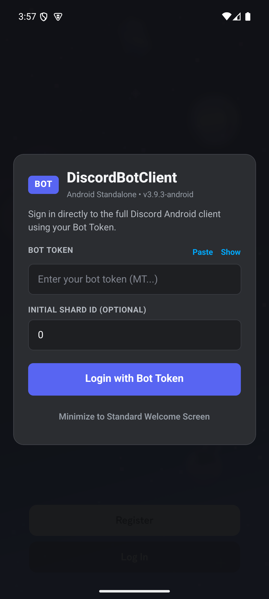
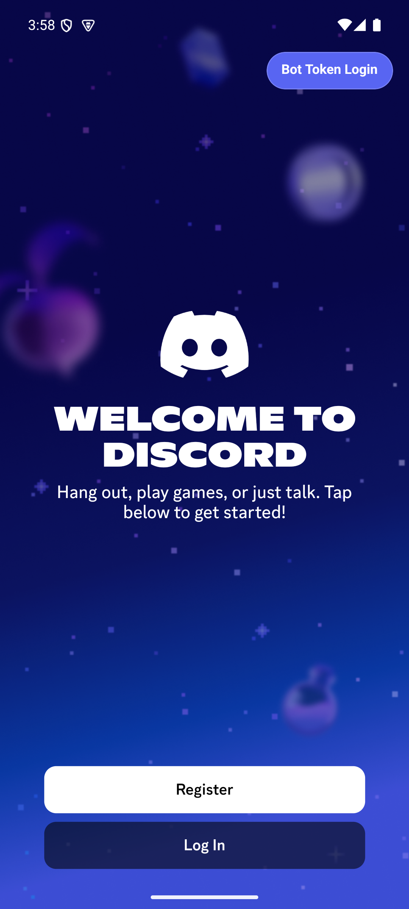
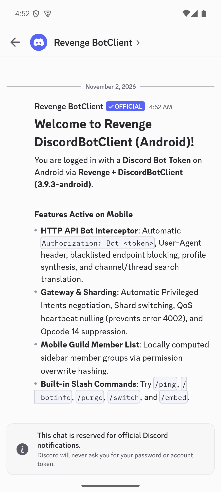
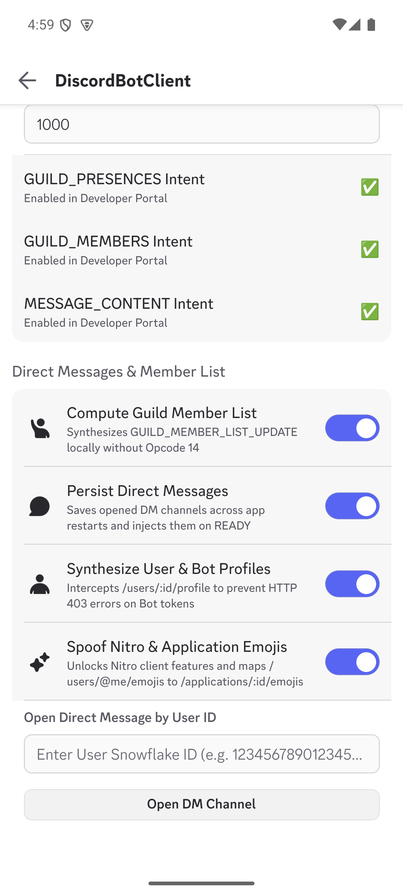
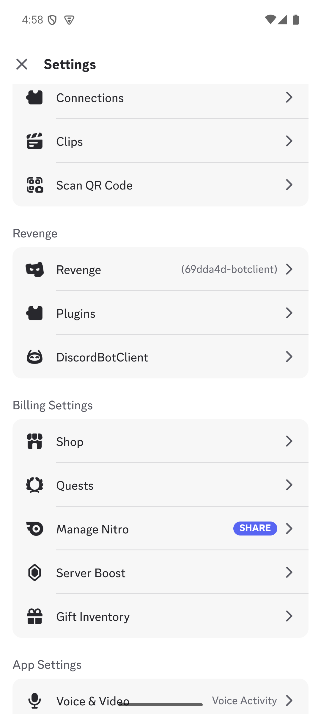
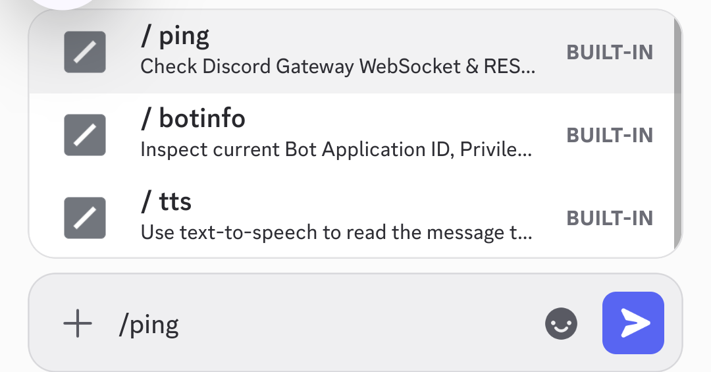
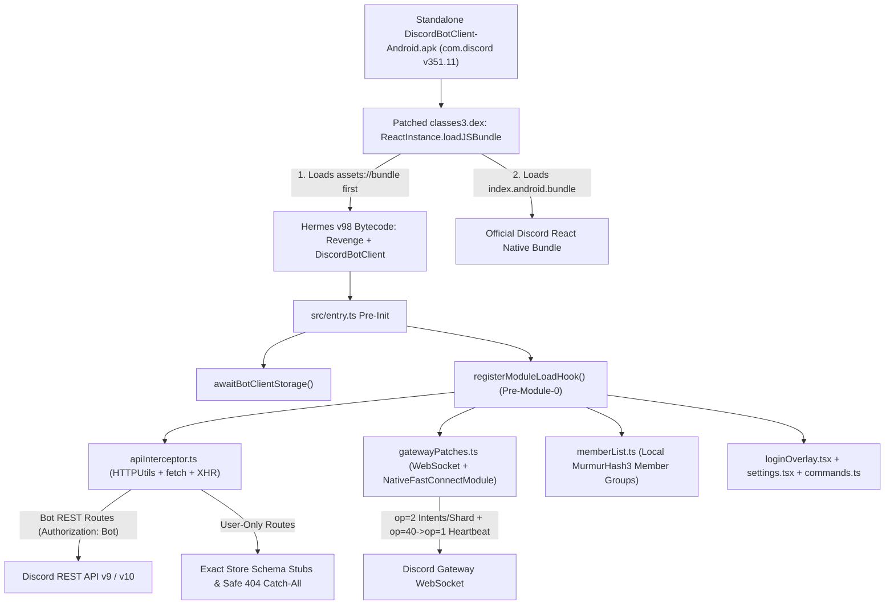

# DiscordBotClient for Android

[](https://github.com/AotianNeo/DiscordBotClient-Android/actions/workflows/build.yml)
[](./LICENSE)
[-5865F2.svg)](https://github.com/AotianNeo/DiscordBotClient-Android/releases)
[](https://github.com/AotianNeo/DiscordBotClient-Android)

A **100% standalone single-APK Discord Bot Client for Android**, bringing the protocol translation architecture of [`aiko-chan-ai/DiscordBotClient`](https://github.com/aiko-chan-ai/DiscordBotClient) directly inside the **complete official native Discord Android client** (`com.discord` v351.11 / build `351011`), powered by [`revenge-mod`](https://github.com/revenge-mod).

Install the single `.apk`, open Discord, paste your **Bot Token**, and use the full native React Native mobile interface as a Discord Bot — **no Root, no Xposed/LSPatch, no Frida, and no external proxy servers required**.

---

## Screenshots

| First-Open Bot Token Login | Minimized Welcome Screen Pill | Official Welcome System DM |
| :---: | :---: | :---: |
|  |  |  |

| DiscordBotClient Settings | Revenge & Plugin Integration | Built-in Slash Commands |
| :---: | :---: | :---: |
|  |  |  |

---

## Key Features

- **First-Open Bot Token Login Modal & Multi-Bot Switcher**:
  - Automatically displays a native **DiscordBotClient** login dialog on launch whenever no active Bot session is present.
  - Supports saving multiple Bot accounts locally for **1-tap instant switching** and clean session logout.
  - Can be minimized to a floating **Bot Token Login** pill on the standard Discord welcome screen at any time.
- **Pre-Module-0 Synchronous Metro Hook Engine**:
  - Hooks `HTTPUtils.HTTP`, `GatewaySocket`, `NativeFastConnectModule`, `TokenManager`, `UserStore`, and `FluxDispatcher` synchronously during Metro module initialization **before** Discord's module `0` boots — guaranteeing crash-free cold starts and warm-session restarts.
- **Pure HTTP REST v9/v10 Bot Interceptor & Safe 404 Catch-All**:
  - Automatically rewrites `Authorization` headers to `Bot <token>` for all official Bot-supported REST routes (`/channels/*`, `/guilds/*`, `/users/*`, `/applications/*`, `/webhooks/*`, `/stickers/*`, `/invites/*`, `/voice/*`, `/Gateway`).
  - Synthesizes user/guild profile payloads (`/users/:id/profile`), translates user-only message/thread search routes into Bot-compatible channel queries, maps `/users/@me/emojis` to `/applications/:id/emojis`, deduplicates `guild_folders` inside `settings-proto/1` protobuf payloads, serves exact mobile store schemas for user-only endpoints (`OFFICIAL_STUBS`), and returns a clean `HTTP 404` JSON response (`{ message: "404: Not Found (BotClient unsupported endpoint)", code: 0 }`) for any unmapped user-only endpoint so tapping any UI button never crashes the app.
- **Gateway WebSocket Wire Translator (Cold & Native Fast-Connect Warm Boot)**:
  - Intercepts both `WebSocket.prototype.send` and React Native's `NativeFastConnectModule.prepareIdentify` so Bot sessions work seamlessly across cold starts and warm restarts.
  - Rewrites `op=2` (`IDENTIFY`) with desktop-bot properties (`$browser: "Discord Client"`), negotiated Privileged Intents (`GUILD_PRESENCES`, `GUILD_MEMBERS`, `MESSAGE_CONTENT` auto-detected via `/oauth2/applications/@me`), and configurable `[shard_id, num_shards]`.
  - Translates mobile `op=40` QoS heartbeats (`{"op":40,"d":{"seq":N,"qos":{...}}}`) into standard `{"op":1,"d":N}` heartbeats so Discord's Gateway never disconnects with close code `4002`.
  - Suppresses user-only Gateway opcodes (`op=14` Lazy Guild Subscriptions, `op=35/36/37` Guild Subscriptions Bulk, `op=41`) that would otherwise terminate a Bot WebSocket connection.
  - Hydrates `guild.properties` on `GUILD_CREATE` / `READY` events for Discord Android v351+ `GuildStore` compatibility and spoofs client-side `bot: false` + Nitro entitlements (`premium_type: 2`) on the authenticated user record while keeping `UserStore.getCurrentUser().getAvatarSource` and MFA/TOTP helpers (`hasTOTPEnabled`) intact.
- **Local Opcode-14 Guild Member List Engine**:
  - Computes channel permission overwrite hashes (`MurmurHash3` 32-bit) and hoisted role groups locally in JavaScript, dispatching `GUILD_MEMBER_LIST_UPDATE` events so channel member sidebars render without sending forbidden `op=14` packets.
- **Persistent Direct Messages**:
  - Persists opened DM channels across app restarts, re-hydrates them into `READY.private_channels`, and allows opening new DMs directly by User Snowflake ID in **Settings -> DiscordBotClient**.
- **Built-in Bot Slash Commands**:
  - `/ping` — Measure live Gateway shard state & REST API latency.
  - `/botinfo` — Inspect Application ID, negotiated Privileged Intents bitfield, and shard topology.
  - `/switch <shard_id>` — Dynamically reconnect the Gateway on a specific shard.
  - `/purge <count>` — Bulk-delete recent messages in the active channel via Bot REST APIs.
  - `/embed <title> | <description>` — Send rich embeds directly from the mobile chat composer.

---

## Architecture



### How the Standalone Single-APK Packaging Works

Official Discord Android (`351.11` / `versionCode 351011`) ships as 4 Google Play Split APKs (`base.apk`, `split_config.arm64_v8a.apk`, `split_config.xxhdpi.apk`, `split_config.en.apk`). [`scripts/build_standalone_discord_apk.py`](./scripts/build_standalone_discord_apk.py) fuses them into a single self-contained APK without `apktool` YAML round-trip corruption:

1. **In-Place Dalvik Bytecode Patch (`classes3.dex`)**: Patches `com.facebook.react.runtime.ReactInstance.loadJSBundle(JSBundleLoader)` in-place (`insns_size = 27` 16-bit code units preserved, zero string/type/method offset shifts) to invoke `this.loadJSBundleFromAssets(this.context.getAssets(), "assets://bundle")` right before Discord's main bundle loader, verified via Android SDK `dexdump`.
2. **Binary AXML Manifest Patch (`AndroidManifest.xml`)**: Strips `android:isSplitRequired`, `android:requiredSplitTypes`, `android:splitTypes`, and `com.android.vending.splits*` `<meta-data>` chunks directly at the binary chunk level so Android `PackageManager` installs the single APK cleanly.
3. **Binary Resource Table Merger (`resources.arsc`)**: Merges `split_config.xxhdpi.apk` and `split_config.en.apk` `ResTable_type` chunks and global/key string pools into `base.apk`'s `resources.arsc`, verified via `aapt2 dump badging` and `aapt2 dump xmltree`.
4. **16 KB Page Alignment & APK Signature Scheme v2**: Embeds `dist/revenge.bundle` as `assets/bundle`, stores `arm64-v8a` native `.so` libraries uncompressed (`ZIP_STORED`), aligns to 16 KB page boundaries (`zipalign -P 16 4`), and signs with APK Signature Scheme v2.

---

## Installation

### Option 1: Install Pre-Built Standalone APK (Recommended)

1. Download **`DiscordBotClient-Android.apk`** from the [latest GitHub Release](https://github.com/AotianNeo/DiscordBotClient-Android/releases).
2. If you already have the official `com.discord` app installed, uninstall it first (signature differs from Google Play).
3. Install `DiscordBotClient-Android.apk` on any `arm64-v8a` Android 8.0+ device or emulator:
   ```bash
   adb install DiscordBotClient-Android.apk
   ```
4. Launch **Discord**, paste your **Discord Bot Token** into the **DiscordBotClient** modal, and tap **Login with Bot Token**.

> **Tip**: Enable **Presence Intent**, **Server Members Intent**, and **Message Content Intent** for your Bot in the [Discord Developer Portal](https://discord.com/developers/applications) so full guild member lists and message bodies are delivered by the Gateway.

---

## Building from Source

### Prerequisites

- [Bun](https://bun.sh/) `>= 1.1` and Node.js `>= 20`
- Python `>= 3.10` with `cryptography` (`pip install cryptography`)
- Android SDK `build-tools` (`aapt2`, `dexdump`, `zipalign`) via `$ANDROID_HOME` or `$ANDROID_SDK_ROOT`
- Clean official Discord Android `351.11` (`351011`) split APKs placed in `apk-build/orig-splits/`:
  - `base.apk` (`SHA256: be46e0063eea1cbf0b38b94e1eae21d4744203dfff594937c0e3466531c4d936`)
  - `split_config.arm64_v8a.apk` (`SHA256: 15bba675d680e755e8584686b7ed66c226625bc53c91977d66364b8f1c40ed8b`)
  - `split_config.en.apk` (`SHA256: a6cf6d363b5d1db957bd006ecbe18013cd7457b770bec10eddf819cfd42f65af`)
  - `split_config.xxhdpi.apk` (`SHA256: 09b821936cc115a93e023592977b63779474a80ef4ca77bd59c427c58d850382`)
  *(Also archived on the [`discord-base-351011`](https://github.com/AotianNeo/DiscordBotClient-Android/releases/tag/discord-base-351011) release tag for reproducible CI builds.)*

### Build Commands

```bash
# 1. Install dependencies
bun install

# 2. Run protocol & Gateway unit tests
bun test

# 3. Compile JS + Hermes v98 bytecode bundle (dist/revenge.bundle) & Revenge plugin
bun run build

# 4. Assemble, 16KB-align, and v2-sign the standalone Android APK
bun run build:apk
# Output: dist/DiscordBotClient-Android.apk
```

---

## Project Layout

```text
├── .github/workflows/build.yml          # Automated CI test, Hermes v98 bundle & APK build
├── docs/screenshots/                    # Sanitized Android UI screenshots
├── scripts/
│   ├── build.mjs                        # esbuild + SWC + Hermes v98 bytecode compiler
│   └── build_standalone_discord_apk.py  # Split-APK merger, DEX/AXML/ARSC patcher & v2 signer
├── src/
│   ├── entry.ts                         # Pre-Module-0 BotClient storage & hook bootstrap
│   ├── metro/internals/                 # Synchronous Metro module load hook engine
│   └── core/plugins/botclient/
│       ├── apiInterceptor.ts            # REST Bot proxy, OFFICIAL_STUBS & 404 catch-all
│       ├── gatewayPatches.ts            # Gateway op=2/op=40/op=14 translator & FastConnect hook
│       ├── memberList.ts                # Local MurmurHash3 GUILD_MEMBER_LIST_UPDATE engine
│       ├── loginOverlay.tsx             # First-open Bot Token Login modal & account switcher
│       ├── settings.tsx                 # Native Discord Settings -> DiscordBotClient screen
│       ├── commands.ts                  # Built-in /ping, /botinfo, /purge, /switch, /embed
│       ├── auth.ts                      # Token validation, Intents calculation & session switch
│       └── storage.ts                   # Persistent multi-bot account & DM channel storage
└── tests/
    └── botclient.test.ts                # 11 protocol, protobuf, Gateway & FastConnect test suites
```

---

## Credits & Acknowledgements

- **[aiko-chan-ai/DiscordBotClient](https://github.com/aiko-chan-ai/DiscordBotClient)** — Original desktop Electron Discord Bot Client inspiration and Bot protocol translation design.
- **[revenge-mod/revenge-bundle](https://github.com/revenge-mod/revenge-bundle)** — React Native / Metro runtime modding framework for Discord Android.

---

## Disclaimer & License

This project is an independent open-source client modification and is not affiliated with, endorsed, or sponsored by Discord Inc. Automating user accounts ("self-bots") violates Discord's Terms of Service; this client is strictly designed for authenticating with official **Discord Bot Tokens** created via the Discord Developer Portal.

Licensed under the [GNU General Public License v3.0](./LICENSE).
